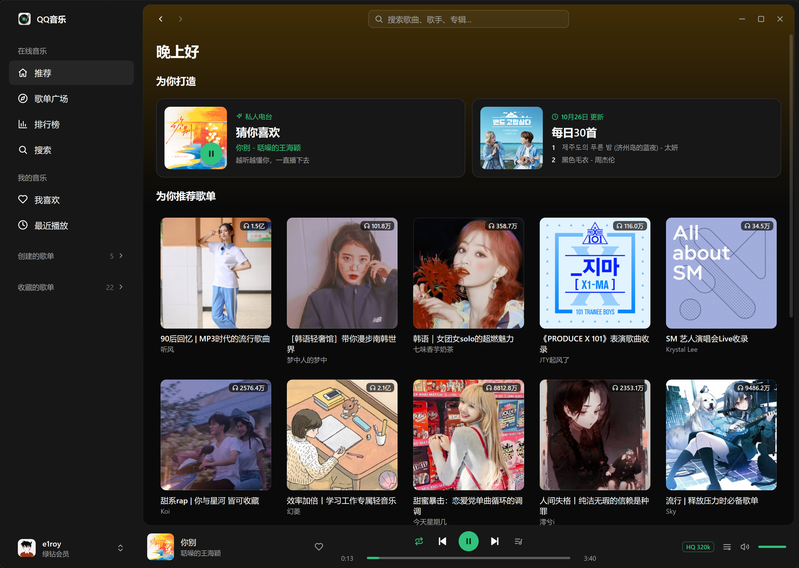
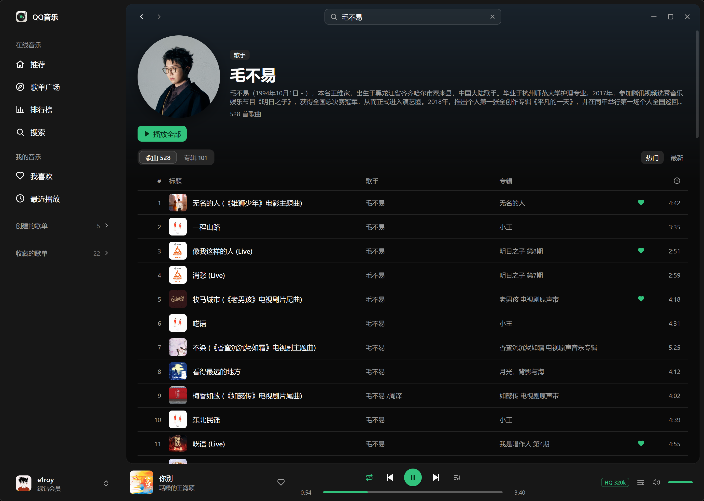

# QQ音乐桌面版

一个用**纯 Go** 编写的 Windows 桌面 QQ 音乐客户端，原生绘制界面，无 WebView、无 cgo、无前端工程。界面为深色主题，主色是 QQ 音乐绿（`#31c27c`）。

## 界面预览

<p align="center">
  
  
</p>

## 功能

| 分类 | 功能 |
|---|---|
| 登录 | QQ 扫码、微信扫码与「QQ 账号」三种登录方式；登录凭证保存在 `%AppData%\QQMusicGo\credential.json`，过期前自动刷新 |
| 发现 | 猜你喜欢、每日 30 首、新歌首发、推荐歌单；歌单广场；排行榜与榜单详情 |
| 搜索 | 单曲、歌手、歌单搜索；歌手与专辑直达卡片；歌手页、专辑页、歌单页详情 |
| 我的音乐 | 「我喜欢」、创建的歌单、收藏的歌单与最近播放；歌曲行与播放栏均可点红心 |
| 播放 | 边下载边解码的 MP3 播放，优先高品质 320k，没有该音质时自动降级为标准 128k；缓冲进度与拖动跳转；音量调节与静音；列表循环、单曲循环、随机播放、顺序播放四种模式；播放队列（下一首播放、加入队列、移除、清空）；无法播放时自动跳过 |
| 歌词与评论 | 模糊封面背景、逐行高亮自动滚动、显示翻译、点击歌词跳转；评论支持热门/最新排序与分页加载 |
| 桌面集成 | 无边框窗口与自绘标题栏；托盘图标单击显示主窗口，右键可播放/暂停、上一首/下一首、退出；快捷键 `Space` 播放/暂停、`Alt+←` / `Alt+→` 后退/前进 |

## 技术栈

- **语言**：Go（`CGO_ENABLED=0`，纯 Go、无 cgo）
- **界面**：[MyGo](https://github.com/egoist/mygo) 原生 UI，声明式构建界面与自绘控件
- **音频**：[go-mp3](https://github.com/hajimehoshi/go-mp3) 解码，边下载边播放
- **数据**：QQ 音乐网页端的非公开接口
- **平台**：Windows，支持系统托盘与 NSIS 安装包

## 构建

需要 Windows 10/11 与 Go 1.27.3 及以上（`GOTOOLCHAIN=auto` 会自动下载对应工具链）。如需使用「QQ 账号」登录，系统还需安装 WebView2 运行时（Windows 11 通常已自带）。

```sh
go run ./cmd/qqmusic                              # 编译并运行
go run ./cmd/genicon -syso                        # 生成 exe 图标资源
go build -ldflags "-H=windowsgui" -o build/QQMusic.exe ./cmd/qqmusic
go tool mygo build                                # 打包 exe 与安装包
```

也可以直接双击 `启动run.bat` 编译并启动；双击 `打包build.bat` 打包，产物在 `build/release/`：

- `QQMusic_v<版本号>_Portable.exe`：免安装，双击即可运行
- `QQMusic_v<版本号>_Setup.exe`：NSIS 安装包，无需管理员权限，会创建开始菜单快捷方式与卸载程序

执行 `打包build.bat 0.2.0` 可以指定版本号，版本号同时会写入 exe 的文件属性。首次打包时 `mygo build` 会自动下载 NSIS。

## 说明

- 获取播放地址必须登录；VIP 歌曲还要求账号本身是 QQ 音乐会员。
- 只支持 MP3 音源。仅有 AAC（m4a）音源的歌曲会提示无法播放并自动跳过。
- 所有数据保存在本机 `%AppData%\QQMusicGo\`。
- 接口来自 QQ 音乐网页端的非公开接口，随时可能变动。本项目仅供学习交流，与腾讯公司无关，QQ 音乐商标及相关内容归其权利人所有。
